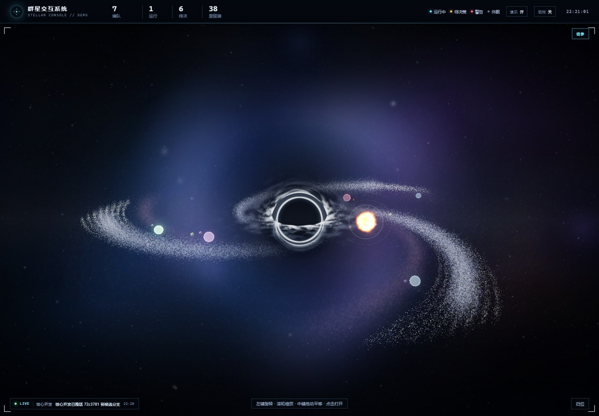
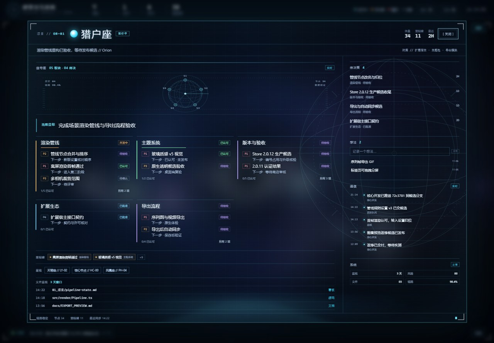

# 群星交互系统 · Stellar Console

> 把项目、目标与信号放进一片可交互的星系。
> A galaxy-shaped project console built with Three.js.



---

## 这是什么

Stellar Console 是一个**以星系为界面**的项目交互中枢：中心是引力透镜下的黑洞，每个项目是一颗发光恒星，插件 / 扩展 / 子模块是绕恒星公转的卫星。点击项目会展开全息控制台，展示目标、板块、任务、里程碑、待决策、想法与实时信号。

它不是某个特定软件的插件，而是一个可嵌入的 Web 界面层：

- **界面即数据**：项目状态、运行 / 等待 / 警告 / 休眠直接影响星体亮度、颜色与生长动效。
- **项目间交互**：项目可以互连（`links`），控制台里可互相跳转；信号会推送到顶部 LIVE 条并点亮对应恒星。
- **开箱即用**：传入一个 `projects` 数组即可运行，其余字段都有默认值。
- **可调参**：黑洞、吸积盘、星盘、星河、行星、Bloom 全部可以在页面右上角实时调节，并保存到 localStorage。

### 控制台



## 功能

- **真实黑洞遮挡**：全屏 Schwarzschild 光线追踪 pass，事件视界会真正遮挡后方银河；项目恒星也放进主场景，遵循实体遮挡，不再叠在黑洞前面。
- **体积吸积盘**：银白色体积盘 + 内缘爆亮 + 外侧快速衰减 + 光子环抗锯齿。盘面云层由两张可平铺 fBm 组成，`云层密度` 控制覆盖率，`横向流速` / `纵向流速` 分别平移 X / Y，`横向平铺` / `纵向平铺` 控制云层尺度，可以拉伸出流动感。
- **3D 项目星系**：项目恒星与卫星都是可替换的渲染模块（皮肤）。内置经典恒星、火焰恒星（表面熔岩 + 可开关 Fresnel 光罩 + 发光云粒子壳 + 偶发耀斑），行星内置岩石 / 冰晶 / 熔岩。
- **星盘控制**：主星粒径 / 亮度、尘埃、雾面、星盘厚度 / 宽度，旋臂内宽、外宽、整体宽度，以及外层星河独立转速 / 主星盘转速。
- **入流速度**：入流粒子的下落速度可独立调节，0 时冻结。
- **背景切换**：面板可开关图片背景、替换图片地址，或改用自定义纯色；`背景光晕` 是总开关，下面单独暴露 `CSS 星云` / `星系大光晕` / `星云团`；支持从系统文件选择器直接选图。透镜天空与星系雾面已移除，纯黑背景不会再出现额外亮斑。
- **DOM + WebGL 混合**：标签、命中区、目标卡、引线用 DOM/SVG，保证可访问性与文字清晰；星体与背景用 WebGL。
- **实时调参面板**：所有主要效果值可实时调整；支持 `?tune={JSON}` 覆盖与 `?panel=0` 隐藏。
- **演示数据**：仓库内的 `Orion / Lyra / Draco / Phoenix / HELIOS / Vega / Atlas` 全部为虚构示例。

## 快速开始

```bash
npm install
npm run dev      # http://127.0.0.1:4173
npm run build    # 产物在 dist/
npm run preview
```

要求 Node.js ≥ 20.19，浏览器需支持 WebGL2。WebGL1 环境会退回一个简化的屏幕空间黑洞。

### 部署

- 任意静态托管：`npm run build` 后上传 `dist/`（构建使用相对路径，可放在子目录）。
- GitHub Pages：`docs/github-pages.yml` 是现成的部署模板。由于 `gh auth login` 默认 token 不含 `workflow` scope，模板暂放在 `docs/`：
  1. `gh auth refresh -h github.com -s workflow`
  2. 把 `docs/github-pages.yml` 移到 `.github/workflows/deploy.yml`
  3. 推送到 `Main`，并在仓库 Settings → Pages 选择 GitHub Actions。

## 嵌入到自己的项目

```js
import { createStellarConsole } from './src/stellar/index.js';

const consoleApp = createStellarConsole({
  mount: '#app',
  data: {
    brand: { title: '我的项目星图', subtitle: 'MY CONSOLE' },
    core: { name: 'CORE', tag: '核心节点' },
    projects: [
      {
        id: 'alpha',
        name: 'Alpha',
        cn: '阿尔法',
        code: 'AL-01',
        r: 1.45,          // 轨道半径
        a: 0.2,           // 轨道角度（弧度）
        p: 8,             // 星体大小
        halo: 130,        // 光晕大小
        hue: 190,         // 色相
        state: 'run',     // run | wait | alert | idle | paused | archived
        starSkin: 'sun',  // classic | sun | 自定义注册
        planetSkin: 'rock',
        phase: '正在推进第一阶段',
        goal: '完成第一阶段验收',
        mass: '12',
        miles: 3,
        last: '2H',
        updated: '今天',
        satellites: ['扩展 A', '主题包'],
        files: [],
        sections: [],
      },
    ],
    decisions: [],
    ideas: [],
    signals: [],
    demoSignals: [],
    links: [],
  },
});
```

`mount` 可以是选择器或 DOM 元素。控制台会接管该容器并注入完整 DOM；样式随 `src/stellar/index.js` 一起加载。

更完整的字段说明见 [数据模型](docs/data-model.md)。

## 公开 API

`createStellarConsole()` 返回：

| 方法 | 说明 |
| --- | --- |
| `openProject(id)` | 打开项目控制台 |
| `closeProject()` | 关闭控制台 |
| `selectProject(id \| null)` | 选中 / 取消选中并显示目标卡 |
| `setProjectState(id, state)` | 修改项目状态并刷新星体标签与 HUD |
| `pushSignal({ project, text, src })` | 推送一条实时信号 |
| `setTune(key, value)` / `getTune()` | 读写调参值（number / boolean / string） |
| `setStarSkin(id, skin)` / `setPlanetSkin(skin, projectId?)` | 切换项目恒星 / 行星皮肤；省略 projectId 时改全局默认 |
| `listStarSkins()` / `listPlanetSkins()` | 列出内置皮肤 |
| `setMotion(on)` / `setDemo(on)` | 开关动效 / 演示信号 |
| `resize()` | 容器尺寸变化后手动刷新 |
| `destroy()` | 停止渲染并清空容器 |

自定义皮肤通过模块导出注册：

```js
import { registerStarSkin, registerPlanetSkin } from 'stellar-console';
```

详见 [数据模型 · 皮肤](docs/data-model.md#皮肤)。

## URL 参数

| 参数 | 说明 |
| --- | --- |
| `?panel=0` / `?panel=1` | 强制关闭 / 打开调参面板 |
| `?tune={"emission":2.6}` | 覆盖任意调参值（JSON） |
| `?quality=low` | 低画质：DPR=1、关闭 Bloom |
| `?nohole=1` | 不启用黑洞 pass |
| `?motion=off` / `on` | 关闭 / 开启动效 |
| `?demo=off` | 关闭演示信号 |
| `?dist=10&yaw=0&pitch=1.2` | 指定相机距离 / 方位 / 俯仰 |
| `?open=orion` `?select=lyra` `?hover=draco` | 直接打开 / 选中 / 悬停项目 |
| `?signalAt=2000` | 2 秒后推送一条演示信号 |

## 项目结构

```
src/
├─ main.js                 演示入口
├─ demo/data.js            虚构演示数据
└─ stellar/
   ├─ index.js             编排 + 公开 API
   ├─ template.js          注入的 DOM 模板
   ├─ data.js              数据归一化
   ├─ tuning.js            调参默认值 / 校验 / 持久化
   ├─ scene.js             Three.js 渲染器、相机、控制器、帧循环
   ├─ galaxy.js            银河、尘埃、入流、星河、远景星、星云
   ├─ blackhole.js         黑洞 pass 与 WebGL1 回退
   ├─ blackhole-shader.js  Schwarzschild 光线追踪 shader
   ├─ bodies.js            3D 项目恒星球 / 卫星
   ├─ stars.js             DOM 星体层与标签
   ├─ projection.js        3D → 屏幕投影与黑洞遮挡
   ├─ target.js            目标卡
   ├─ leader.js            选中引线
   ├─ console-view.js      全息控制台
   ├─ tune-panel.js        实时调参面板
   ├─ signals.js           LIVE 信号与动效开关
   ├─ hud.js               顶部态势
   ├─ textures.js          程序化贴图
   ├─ skins/               恒星 / 行星皮肤注册表与内置实现
   ├─ core/                小工具
   └─ styles/              分模块 CSS
```

更细的模块职责与渲染顺序见 [架构说明](docs/architecture.md)。

## 调参

右上角「调参」面板分为黑洞、星盘、行星、辉光、星河、入流六组。值会写入 `localStorage`（默认前缀 `stellar-console`），也可以 `?tune=` 传入 JSON 做一次性覆盖。

完整参数表见 [调参说明](docs/tuning.md)。

## 性能

- 默认主星 140k、尘埃 140k、入流 28k、外层星河 20k、远景星 18k。
- 全屏黑洞 pass 的步数上限 260，在吸积盘附近自动加密。
- DPR 上限 1.5；`?quality=low` 时 DPR=1 并关闭 Bloom。
- 低端 GPU、移动端与 Obsidian 内嵌环境的实际帧率仍需按目标设备实测。

## 路线图

- [ ] 数据适配器：Obsidian、Jira、GitHub Projects、本地 JSON / YAML。
- [ ] 事件总线：项目状态、任务、信号的外部增量更新。
- [ ] 更多场景：双星系统、星团、可切换的视角预设。
- [ ] 384² / 20fps 的降级预设。
- [ ] 插件化视图（Obsidian 等）。

## 致谢

- 黑洞几何与吸积盘实现的思路参考了 [rossning92/Blackhole](https://github.com/rossning92/Blackhole) 以及其 README 中列出的论文；本仓库的 shader 是针对浏览器实时渲染重写的实现。
- 渲染基于 [Three.js](https://threejs.org/)（MIT）。

## License

[MIT](LICENSE)

---

## English

Stellar Console is a galaxy-shaped project console: a lensing black hole at the centre, each project a glowing star, its plugins orbiting as satellites. It ships the rendering layer and the project-to-project interaction model only — no personal vault data.

```bash
npm install && npm run dev
```

Pass a `projects` array to `createStellarConsole({ mount, data })` and you have a running console. See [data model](docs/data-model.md) and [architecture](docs/architecture.md).
